<!-- Muhammad Sohaib Khan · https://muhammadsohaib.si -->

<i>Rendered with Three.js + custom GLSL shaders · <a href="webgl">source</a></i>

<b>I architect and build enterprise platforms and agentic AI systems end to end — from the first diagram to a production deployment international teams depend on.</b>

 

  

Founders, teams and the simply curious: you are all welcome here.

  

<!-- ═══ ABOUT ═══ -->

Before I touch the keyboard I ask one question: **will this create real business impact?** It decides the architecture, and it is why clients keep coming back.

I work where full-stack engineering meets artificial intelligence — building complete products from database schema to a deployed, revenue-ready application. On the AI side that means **agentic systems that reason, plan, retrieve, use tools and execute multi-step workflows**: multi-agent orchestration, RAG pipelines, copilots, conversational and voice AI, document understanding and intelligent automation for real operations.

I communicate plainly, challenge requirements that do not serve the business, and think past the code into architecture, scalability, security and return.

| 500+ | 180+ | 120+ | 80+ | 50+ | 50+ | 40+ | 10+ |
|:--:|:--:|:--:|:--:|:--:|:--:|:--:|:--:|
| Projects delivered | Web & SaaS products | API & systems integrations | MVPs idea to launch | CRM & ERP systems | Client countries | Mobile apps shipped | Years in production |

### 🛰️ &nbsp;Currently leading

<table>
<tr>
<td width="50%" align="center"><a href="https://www.airmansground.com/"><b>Airman's Ground</b></a> Aviation platform · Riyadh, Saudi Arabia  <b>Chief Technology Officer</b></td>
<td width="50%" align="center"><a href="https://solnetinfo.com/"><b>SolnetInfo</b></a> AI & software company · Ontario, Canada  <b>Technical Lead · Lead Software & AI Engineer</b></td>
</tr>
</table>

<!-- ═══ SERVICES ═══ -->

<table>
<tr>
<td width="33%" valign="top"><b>01 · AI-Powered Solutions</b> Chatbots, autonomous agents, AI search, RAG and end-to-end automation on OpenAI, LangChain and Gemini.</td>
<td width="33%" valign="top"><b>02 · Full-Stack Web Development</b> Custom web apps, SaaS and AI products — React and Next.js in front, FastAPI, Node, Nest, Django and Laravel behind.</td>
<td width="33%" valign="top"><b>03 · UI/UX Design & Development</b> Responsive interfaces designed in Figma and XD, built pixel-perfect with Tailwind, MUI and Chakra.</td>
</tr>
<tr>
<td valign="top"><b>04 · Mobile App Development</b> Cross-platform React Native apps with AI-driven features, integrated with your web and backend.</td>
<td valign="top"><b>05 · API Development & Integrations</b> Secure, documented APIs plus integrations across OpenAI, payments, CRMs and third parties.</td>
<td valign="top"><b>06 · Software Architecture & Consulting</b> Scalable, maintainable systems, cloud and DevOps on AWS, Azure and Docker, Core Web Vitals.</td>
</tr>
<tr>
<td valign="top"><b>07 · AI Voice Receptionist</b> Answers calls naturally, qualifies callers, books appointments and writes straight back to your CRM.</td>
<td valign="top"><b>08 · Product Design & Development</b> Discovery, UX, a Figma design system, then the build — one accountable line from sketch to launch.</td>
<td valign="top"><b>09 · Motion Design & Development</b> UI motion, micro-interactions and product reels — After Effects to GSAP, Framer Motion, Lottie and Three.js.</td>
</tr>
</table>

### 🚀 &nbsp;Designed with care, shipped with AI speed

 

 

<!-- ═══ AGENTS ═══ -->

<i>Representative execution trace — the pattern I build for clients, not a live session.</i>

<table>
<tr>
<td width="50%" valign="top">

**Solutions can include**
- Support, FAQs, sales and lead qualification
- RAG over websites, PDFs, documents, databases or APIs
- Grounded answers with citations and memory
- Agentic workflows for booking, CRM updates and email
- Human approval, handoff, permissions and guardrails
- Web search, file search, function calling and MCP tools
- Voice receptionists and inbound / outbound calling agents
- Branded widget, analytics and cloud deployment

</td>
<td width="50%" valign="top">

**Modern stack**
- OpenAI Responses API and Agents SDK
- Anthropic API and Agent SDK
- LangChain and LangGraph · CrewAI
- Python · FastAPI · Node.js · Next.js
- PostgreSQL, pgvector, Pinecone, Qdrant, Weaviate
- Vapi · Retell AI · ElevenLabs for voice
- n8n for workflow automation

> I select the model on accuracy, privacy, speed and cost — not on habit.

</td>
</tr>
</table>

<i>Reference architecture — every layer instrumented, versioned and owned.</i>

<!-- ═══ SELECTED WORK ═══ -->

| # | Project | What it is | Result | Built with |
|:--:|:--|:--|:--|:--|
| 01 | **Enterprise OS Intelligence Dashboard** | SaaS dashboard with KPI tracking, automated workflows and finance-grade reporting | 99.9% uptime · 300% productivity lift | `Next.js` `TypeScript` `Supabase` |
| 02 | **Convyra — AI Sales Agent** | Answers WhatsApp and Instagram DMs in the brand's voice, qualifies leads, books the sale | DMs keep selling while you sleep | `React` `Framer Motion` |
| 03 | **AI Real Estate Copilot** | Conversational property search, portfolio insights and 3D tour scheduling | Search across the full listing portfolio | `Next.js` `Three.js` `LangChain` |
| 04 | **Meridian — AI Agents Platform** | Voice, chat and ops agents that update systems and hand off to a person | One platform, four kinds of agent | `React` `Supabase` |
| 05 | **Legal AI Intake Agent** | Client-intake cockpit with AI case triage and document intelligence | 70% lower intake handling cost | `Next.js` `LangChain` `Clerk` |
| 06 | **Language Planet AI — Voice Tutor** | Lessons, games and Lumi, an AI voice tutor learners talk to | Learn languages by speaking | `Next.js` `Voice AI` |
| 07 | **AI Document Intelligence Suite** | RAG document hub: PDF ingestion, Q&A and executive summaries | 80% faster response · 45% higher satisfaction | `Python` `FastAPI` `Pinecone` |
| 08 | **[Infinity Predictive](https://infinitypredictive.com/)** | Real-time prediction market with live odds and charts | Trade on what happens next | `React` `Vite` |
| 09 | **Vetlumi — Connected Veterinary Care** | Find vets, book, and coordinate rescue-to-recovery care, installable as an app | Global healthcare PWA | `React` `Supabase` `PWA` |
| 10 | **Luxury Builder Brand Site** | Editorial brand site with oversized serif type and a studio clock | Concept to launch | `Next.js` `GSAP` `Tailwind` |

Most of the 500+ delivered projects live in private repositories under NDA. Architecture walkthroughs, references and code samples are available on request.

<!-- ═══ STACK ═══ -->

**AI & LLMs**

 

**Frontend · Backend · Mobile**

**Data · Cloud · DevOps**

**Vectors · Automation · Design**

<!-- ═══ EXPERIENCE ═══ -->

| Company | Role | Period |
|:--|:--|:--|
| **[Airman's Ground](https://www.airmansground.com/)** · Riyadh | Chief Technology Officer · Senior Software Architect | Dec 2025 – Present |
| **[eFinancialCareers](https://www.efinancialcareers.com/)** · UK, remote | Lead AI Solutions Architect & Forward Deployed Engineer · Technical Lead | Oct 2025 – Oct 2026 |
| **[SolnetInfo](https://solnetinfo.com/)** · Canada | Technical Lead · Lead Software & AI Engineer | Feb 2018 – Present |
| **Jitter App Pty Ltd** · Australia | Senior Forward Deployed Engineer · Senior Lead AI Engineer | Jan 2025 – Mar 2026 |
| **[Infinity Gaming](https://infinitypredictive.com/)** | Principal Software Architect & Lead Full-Stack Engineer | Feb 2025 – Sep 2025 |
| **SafeAngels** | Technical Lead · Senior Mobile Application Engineer | Jun 2024 – Feb 2026 |
| **Creative Global Pakistan** | Team Lead · Senior Software Engineer | Sep 2023 – Nov 2024 |
| **Axis Coding Solutions** | IT Technical & Business Development Manager | Jan 2021 – Oct 2023 |
| **Remotebase** | Senior Software Engineer | Sep 2019 – Aug 2022 |
| **AgriVoice Buddy** · **RaheeAI — Kids Gari** | Founder | 2022 – Present |

### 🏆 &nbsp;Recognition

<table>
<tr>
<td width="25%" align="center"><b>Devpost</b> 4× hackathon awardee, 2× finalist in AI product design and development</td>
<td width="25%" align="center"><b>Shell Tameer · 2024</b> Top 30 finalist, 11th Tameer Awards, selected from 500+ ventures</td>
<td width="25%" align="center"><b>Telenor Velocity · 2025</b> Standout finalist with AgriVoice Buddy for agritech innovation</td>
<td width="25%" align="center"><b>LGU BIC · 2022</b> Kids Gari, now RaheeAI, in the first incubation centre cohort</td>
</tr>
</table>

<!-- ═══ CLIENT VOICES ═══ -->

<table>
<tr>
<td width="50%" valign="top">

> *"He's proactive, adding functionality that makes sense that might not have been in my requirements document. He's communicative, keeping in close contact despite our time zone differences. I'm not sure how I got so lucky to have found him."*
>
> — **United States** · 2026

</td>
<td width="50%" valign="top">

> *"What he has delivered as our blueprint has far exceeded my expectations. We are now in a very good place to achieve and execute our project goals."*
>
> — **Australia** · 2025

</td>
</tr>
<tr>
<td valign="top">

> *"Produced all the necessary architecture diagrams and understood the project well. Within only 1 day Muhammad drew up the necessary documents."*
>
> — **United Kingdom** · 2025

</td>
<td valign="top">

> *"Delivered everything as promised, with clear documentation, clean code, and strong backend logic. Even under pressure, he stayed communicative and went beyond scope."*
>
> — **Verified client**

</td>
</tr>
<tr>
<td valign="top">

> *"He came to our meeting very prepared. Muhammad provided an exceptional post-meeting report that was well worth the booking fee itself."*
>
> — **United States** · 2026

</td>
<td valign="top">

> *"There's nothing better than getting delivery of a work milestone early! Huge thank you for his ongoing professionalism and expertise."*
>
> — **United States** · 2026

</td>
</tr>
</table>

<!-- ═══ TRACK RECORD ═══ -->

<!--STATS:START-->

 

<!--STATS:END-->

🔄 &nbsp;<i>Refreshed every day from the GitHub GraphQL API by <a href="scripts/update-stats.mjs">scripts/update-stats.mjs</a></i>

  

### 🎓 &nbsp;Certified & verified

 

<!-- ═══ CONTACT ═══ -->

<table>
<tr>
<td width="50%" valign="top">

### Why clients choose me
1. **Architect first** — no code before the design is agreed
2. **AI that ships** — agents, RAG and automations in production, not a demo
3. **One accountable person** — frontend to infrastructure, no vendor hand-offs
4. **Clean handover** — docs, runbooks and ADRs so you're never dependent on me
5. **Security by design** — threat model before code; data stays in your region, never used for training

</td>
<td width="50%" valign="top">

### Available for
- Remote senior, staff and principal roles — full-stack, AI and agentic systems, forward deployed
- Contract work across AI agents, SaaS, web, mobile and automation
- Fixed-scope builds, monthly retainers, fractional CTO and architecture audits
- Architecture consulting and technical advisory
- Partnerships with funded startups, agencies and business owners

</td>
</tr>
</table>

<b>Before you book — common questions</b>

 

**How does an engagement start?** A free 30-minute call. Within days you get a written scope, architecture outline and a fixed price or retainer proposal. No commitment until you say yes.

**Can you work with my existing team and codebase?** Yes — most engagements do. Audits, legacy modernisation and joining an existing team are standard.

**How do you handle security?** Every build starts with a threat model and data-flow diagram. Data is encrypted at rest and in transit, agents get least-privilege allow-listed tools with audit logs, following the OWASP Top 10 for LLM applications.

**Who owns the code and IP?** You do, entirely. NDA on request.

 

  

 

